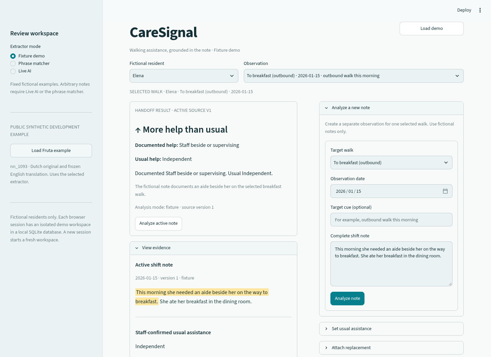

# CareSignal

CareSignal highlights what a shift note documents about human help for a selected walk, then compares that evidence with a staff-confirmed description of the resident’s usual help when one is available.

This project is a prototype and is not medical advice.



## Run it

Requires Python 3.11+ and [uv](https://docs.astral.sh/uv/).

```bash
git clone https://github.com/Tanay-bot/caresignal.git
cd caresignal
uv sync --locked --extra dev
uv run streamlit run app.py
```

Open http://localhost:8501. **Fixture demo** runs without API credentials. With an existing Python environment, `python -m pip install -e '.[dev]'` and `streamlit run app.py` also work; `uv.lock` records the exact verified dependency set.

For a quick offline walkthrough without a browser:

```bash
uv run python -m caresignal.demo
```

## Try the handoff

1. Click **Load demo** and select **Elena**. The note documents an aide beside her on the breakfast walk; her confirmed usual level is independent, so the card shows **More help than usual**.
2. Select **Ruth**. The same note now shows **Matches usual routine** because her confirmed baseline is supervision for that walk.
3. Return to Elena, open **Attach replacement**, click **Use demo replacement**, then submit. The new active note leaves human help unspecified, so the prior flag clears. **Note history** retains the original as corrected version 1.
4. Load **Fruta example** to inspect real public synthetic development note `nn_1093`, its frozen English translation, exact two-sentence evidence and Dutch original. The preset uses the selected extraction mode and identifies fixture output explicitly.

The app supports complete custom fictional notes, selected dates and walk contexts, explicit usual-assistance confirmation, exact evidence highlights, immutable correction history and retryable analysis failures. It reports five documentation labels: Independent, Staff beside or supervising, Hands-on help, Help documented/type unspecified and Unclear.

Each browser session has an isolated fictional demo workspace in local SQLite. A new session starts a new workspace. Set `CARESIGNAL_DATA_DIR` to choose the storage directory; the default is the system temporary directory under `caresignal/`. **Load demo** resets only the current workspace. The database is excluded from Git.

## Enable Live AI

Choose a live provider and export its API key in the shell that starts Streamlit. `.env.example` documents both providers; the app does not automatically load `.env` files.

| Provider | Key variable | Optional model variable | Default requested model |
| --- | --- | --- | --- |
| Gemini | `GEMINI_API_KEY` | `GEMINI_MODEL` | `gemini-3.8-flash` |
| OpenAI | `OPENAI_API_KEY` | `OPENAI_MODEL` | `gpt-4.1-mini` |

For Gemini, create an API key in [Google AI Studio](https://aistudio.google.com/api-keys), then start the app from that shell:

```bash
export GEMINI_API_KEY='your-api-key'
uv run streamlit run app.py
```

Select **Live AI**, then choose **Gemini** in **AI provider**. OpenAI remains available with `OPENAI_API_KEY`. The Gemini default completed the recorded development check below; OpenAI live availability remains unverified. `GEMINI_MODEL` and `OPENAI_MODEL` override the defaults.

You can also keep the key in a local ignored `.env` file: copy `.env.example` to `.env`, fill in your selected provider's key, then launch with explicit environment loading:

```bash
uv run --env-file .env streamlit run app.py
```

`uv` loads that file for the launched process; the app itself does not read it. Keep `.env` private and out of Git.

Both native SDK adapters request structured output and check exact evidence locally. Every result records the requested model, extractor/prompt versions and input hash. Missing credentials, provider errors and invalid citations produce an unavailable card instead of a guessed finding. **Phrase matcher** is a separate, transparent baseline. **Fixture demo** supports only frozen walkthrough inputs and clearly explains unsupported custom input.

**Gemini live inference is verified on the disclosed Fruta development example `nn_1093`:** `gemini-3.8-flash` returned Hands-on help and the exact two-sentence evidence. This single development check does not estimate held-out performance. OpenAI live inference remains pending.

## Verify and evaluate

```bash
uv run pytest
uv run ruff check .
uv run ruff format --check .
uv run python -m caresignal.evaluation --dataset data/fictional_development.jsonl --mode phrase --output-dir artifacts/development
uv run python -m caresignal.evaluation --dataset data/fruta_development.jsonl --mode phrase --output-dir artifacts/fruta-development
# Requires GEMINI_API_KEY; compare the phrase baseline with Gemini on the same inputs:
uv run python -m caresignal.evaluation --dataset data/fruta_development.jsonl --mode compare --provider gemini --output-dir artifacts/fruta-gemini
```

The runner writes per-example JSON/CSV and a generated Markdown summary, including exact counts, source/translation revisions, dataset hash, prompt/extractor versions and model identifier. Label, exact span-set evidence and joint accuracy include errors in the denominator. The notebook [01_walkthrough.ipynb](notebooks/01_walkthrough.ipynb) calls the same package functions as the app.

Recorded **development-only phrase checks** are in [docs/development-results](docs/development-results). These small examples check behavior and reveal strict evidence mismatches; they do not estimate generalization or AI performance.

<!-- BEGIN DEVELOPMENT RESULTS -->
| Mode | Model | Scope | N | Label | Exact evidence | Joint | Errors |
| --- | --- | --- | ---: | ---: | ---: | ---: | ---: |
| phrase | none | fictional_development | 7 | 7/7 (100.0%) | 5/7 (71.4%) | 5/7 (71.4%) | 0 |
| phrase | none | public_development | 1 | 1/1 (100.0%) | 1/1 (100.0%) | 1/1 (100.0%) | 0 |
<!-- END DEVELOPMENT RESULTS -->

Recorded **live Gemini development check** on public synthetic `nn_1093`: the actual provider result and exact evidence are preserved in [docs/gemini-development-results](docs/gemini-development-results).

<!-- BEGIN GEMINI DEVELOPMENT RESULTS -->
| Mode | Model | Scope | N | Label | Exact evidence | Joint | Errors |
| --- | --- | --- | ---: | ---: | ---: | ---: | ---: |
| gemini | gemini-3.8-flash | public_development | 1 | 1/1 (100.0%) | 1/1 (100.0%) | 1/1 (100.0%) | 0 |
<!-- END GEMINI DEVELOPMENT RESULTS -->

The run used extractor `gemini-structured-v1`, shared prompt `walking-assistance-v1`, pinned Fruta revision `579141e3431c18a932fa3a0870e9f1c131f10367`, and translation `caresignal-agent-en-literal-v1`. That English translation was authored by the coding agent and has not been independently reviewed. The one example was disclosed during development; its result is not a held-out performance claim.

**Held-out Fruta evaluation is pending.** Freeze a translated, independently annotated held-out sample before reviewing predictions. `nn_1093` is a disclosed development example and cannot be used as held-out data. Fixture mode cannot score held-out data. Once the frozen held-out sample is available, `--mode compare --provider gemini` runs the phrase matcher and Gemini on identical notes and targets. `--provider openai` selects OpenAI and remains the CLI default; `--mode live` runs only the selected live adapter. See [evaluation.md](docs/evaluation.md) for the input contract and reporting procedure.

## Project map

| Location | Purpose |
| --- | --- |
| `app.py` | Streamlit handoff screen |
| `caresignal/models.py` | Frozen contracts, labels and context catalog |
| `caresignal/evidence.py`, `comparison.py` | Exact citations, eligibility checks and deterministic comparisons |
| `caresignal/repository.py`, `service.py` | Workspace-scoped SQLite, baseline snapshots and atomic replacements |
| `caresignal/extractors.py` | Fixture, phrase and replaceable Gemini/OpenAI adapters |
| `caresignal/evaluation.py` | Frozen-data evaluation and reproducible exports |
| `data/` | Fictional development checks and sourced Fruta development example |
| `tests/` | Domain, service, extraction, evaluation and Streamlit flow checks |
| `.github/workflows/ci.yml` | Python 3.11/3.12 verification |

Read the [original brief](docs/project-brief.txt), [architecture](docs/architecture.md), [demo script](docs/demo-script.md), [prompt policy](docs/prompt.md), [Fruta provenance](docs/fruta-source.md) and [verification record](docs/verification.md).

The source Fruta dataset is public synthetic Dutch documentation, pinned to revision `579141e3431c18a932fa3a0870e9f1c131f10367`. The included English translation was authored by the coding agent and has not been independently reviewed. Demo residents and walkthrough notes are fictional. Clinical interpretation, urgency, fall-risk scoring, treatment, production patient records and clinical-system integration remain outside the prototype scope.
